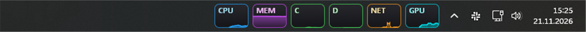
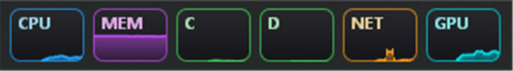
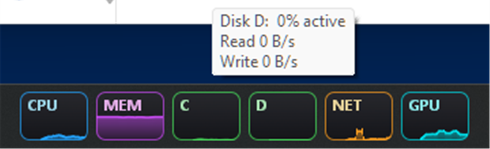

# Activity Monitor

Tiny, Task Manager–style performance meters that live **in your Windows taskbar**, right next to the clock and notification area. No window, no tray icon, no dashboard to open — just live graphs for:

| Meter | What it shows |
|-------|---------------|
| **CPU** | Total processor utilisation |
| **MEM** | Physical memory in use |
| **C** | Disk activity of the `C:` drive (active time, like Task Manager) |
| **D** | Disk activity of the `D:` drive (hidden automatically if the drive is absent) |
| **NET** | Combined download + upload throughput of physical adapters (auto-scaling graph) |
| **GPU** | GPU utilisation (NVIDIA via NVML, any other GPU via Windows performance counters) |





Hover a meter for the details:



## Features

- **Looks like Task Manager** – each meter is a thumbnail graph with the same accent colours as the Performance tab (dark theme), rounded corners, a smoothed anti-aliased line and a soft gradient fill. Light taskbar themes are supported too.
- **Very low overhead** – a single native Rust executable (~150 KB, no runtime). One 1 Hz timer, only cheap kernel counters, no allocations in the steady state, and a working set of roughly 1.5–2 MB.
- **Sits in the taskbar** – attaches to the taskbar as a child window and positions itself left of the notification area. It follows DPI/scale changes, display changes, theme changes, and re-attaches itself if Explorer restarts.
- **Details on hover** – memory used / total, disk read/write rates, network up/down rates, VRAM usage.
- **Right-click menu** – *Open Task Manager*, *Start with Windows*, *Exit*. Double-click a meter to open Task Manager.
- **Single instance** – starting it twice does nothing.

## How it measures (and why it is cheap)

| Meter | Source |
|-------|--------|
| CPU | `GetSystemTimes` deltas |
| Memory | `GlobalMemoryStatusEx` |
| Disks | `IOCTL_DISK_PERFORMANCE` on `\.\C:` / `\.\D:` (idle-time delta → active time, plus byte counters) |
| Network | `GetIfTable2` octet counters, hardware interfaces only (no double counting of virtual/loopback adapters) |
| GPU | NVML (`nvmlDeviceGetUtilizationRates`) if `nvml.dll` is present; otherwise the `GPU Engine` PDH counters (highest engine type, like Task Manager) |

Rendering is done in software into a small premultiplied-alpha bitmap that is pushed with `UpdateLayeredWindow` once per second.

## Install

### MSI (recommended)

Build the installer (see below) and run `installer\ActivityMonitor.msi`. It is a **per-user** install (no admin rights needed):

- installs to `%LocalAppData%\ActivityMonitor`
- registers the app to **start with Windows** (`HKCU\Software\Microsoft\Windows\CurrentVersion\Run`)
- starts it immediately; upgrades and uninstalls close the running instance first

Silent install / uninstall:

```powershell
msiexec /i installer\ActivityMonitor.msi /qn
msiexec /x installer\ActivityMonitor.msi /qn
```

### Portable

Just run `ActivityMonitor.exe`. Use the right-click menu to toggle *Start with Windows*.

## Build

Requirements: Windows 10/11, [Rust](https://rustup.rs) (MSVC toolchain).

```powershell
cargo build --release
```

The executable is written to `target\release\ActivityMonitor.exe`.

### Build the MSI

Requires the [WiX Toolset](https://wixtoolset.org) v5:

```powershell
dotnet tool install --global wix
cargo build --release
wix build installer\Product.wxs -arch x64 -o installer\ActivityMonitor.msi
```

## Project layout

```
src/main.rs          the whole application (sampling, rendering, window management)
app.manifest         DPI awareness, Win8+ compatibility (layered child windows), common controls v6
build.rs             embeds the manifest
installer/Product.wxs  WiX source for the per-user MSI
docs/                screenshots
```

## Notes & limitations

- Targets the primary (bottom) taskbar on Windows 10/11. Vertical or secondary-monitor taskbars are not handled.
- The `C` and `D` meters are fixed to those drive letters.
- On hybrid-graphics laptops, NVML polling can keep the NVIDIA GPU awake; run with `--pdh` to force the performance-counter path instead.

## License

[MIT](LICENSE)
